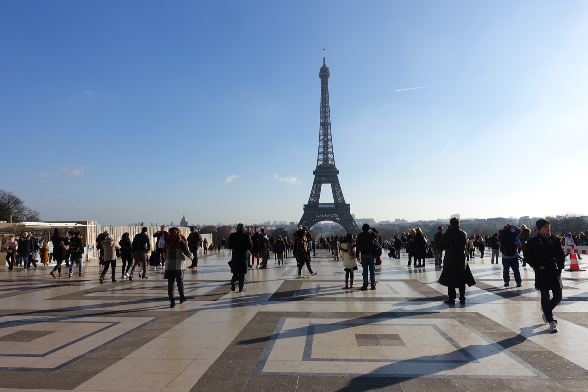
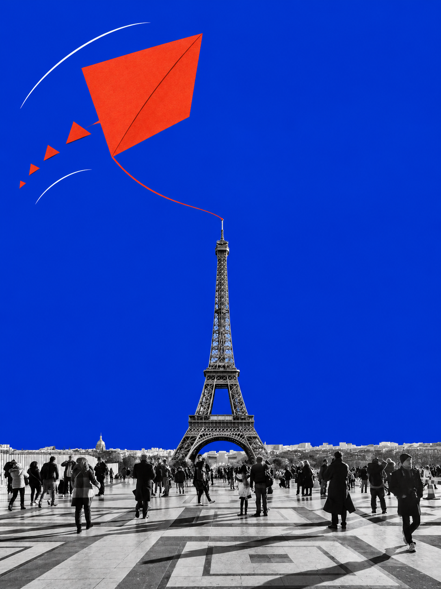

# 巴黎铁塔与天空风筝

本轮演示生成的单张练习案例，展示“真实地标照片 → 单一巨物与大色域拼贴”。

## 真实照片输入与许可

摄影：Guilhem Vellut，2016-12-03。作品：Paris Parvis des Droits de l'homme 20161203 Eiffel Tower.jpg。

- [Wikimedia Commons 原照与署名](https://commons.wikimedia.org/wiki/File:Paris_Parvis_des_Droits_de_l%27homme_20161203_Eiffel_Tower.jpg)
- [CC BY 2.0 许可](https://creativecommons.org/licenses/by/2.0/)
- [原始照片文件](https://upload.wikimedia.org/wikipedia/commons/3/34/Paris_Parvis_des_Droits_de_l%27homme_20161203_Eiffel_Tower.jpg)

输入为原照的等比缩略副本；原始照片仍归摄影者，本例不暗示其认可本次改编，也不把照片素材改列为代码许可。

## 本轮 AI 改编

场景卡以铁塔收束轮廓、四腿拱门、广场透视为不可遮挡锚点。原蓝天提纯为钴蓝平涂色域；铁塔与广场为黑白摄影拼贴；天线接住一只巨大红色风筝。四片同源小纸片和两条白色动势线服务于同一巨物。

变化声明：竖版重构、去色、天空改色、新增风筝与动势元素，均由 AI 编辑完成；不是纪实原片。已实际查看原照和输出，核对地标轮廓、连接点、主色数量与小元素；图像生成仍重绘了人群及部分纹理。

这是单张示例，不代表 6–12 张系列的色相矩阵、联系表和整组一致性已完成。
